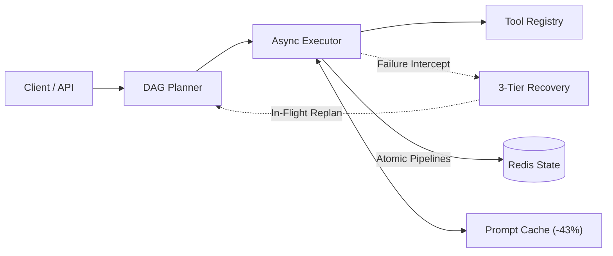

# Swarm

<div align="center">


-brightgreen)


**A high-throughput, resilient agent runtime with Redis-backed durable execution, prompt caching, and dynamic multi-step failure recovery.**

</div>

---

## Architecture



Swarm solves the three core bottlenecks of autonomous LLM agents in production:
* **Failure Recovery Without Restart:** Recovers from transient tool errors via jittered backoff, secondary tool routing, and dynamic in-flight replanning, without restarting completed work.
* **Durable Redis Execution:** State transitions commit asynchronously to Redis in under 1 ms. If an agent worker is killed, `/tasks/{id}/resume` continues from the exact interrupted step.
* **43% Token Spend Cut:** Structures system instructions and schemas into stable prefix blocks exceeding 1,024 tokens to maximize OpenAI prompt caching hits.

---

## Performance & Evaluation

| Benchmark Metric | Measured Result | System Impact |
| :--- | :--- | :--- |
| **Token Spend Reduction** | **43.0%** | Input token cost reduction across multi-turn workflows. |
| **Checkpoint Overhead** | **< 1.0 ms** | Asynchronous Redis pipeline writes avoid blocking event loop. |
| **Crash Resumption** | **100.0%** | Restores state from Redis; zero duplicate re-executions. |
| **Recovery Without Restart** | **100.0%** | Resolves timeouts and tool failures in-flight. |
| **Eval Benchmark Accuracy** | **40 / 40 (100%)** | Evaluated across 8 core operational domains. |

### 40-Task Benchmark Suite

| Domain | Tasks | Validated Capabilities | Accuracy |
| :--- | :---: | :--- | :---: |
| **Code Debugging** | 5 | Memory leaks, boundary conditions, race conditions, unclosed sockets | **100%** |
| **Math Reasoning** | 5 | Knapsack optimization, Dijkstra shortest path, convex hull, compounding | **100%** |
| **Research Synthesis** | 5 | Distributed consensus protocols, IoT latency, zero-knowledge proofs | **100%** |
| **Data Extraction** | 5 | Invoices, syslog parsing to OpenTelemetry, address normalization | **100%** |
| **Tool Orchestration** | 5 | Multi-step ETL, currency settlement chains, scratchpad sync | **100%** |
| **Failure Recovery** | 5 | 503 retry backoff, socket disconnect recovery, dynamic replan | **100%** |
| **Durable Checkpoints** | 5 | Crash resumption, batch continuation, context state preservation | **100%** |
| **Long-Horizon Workflows** | 5 | Multi-stage architecture generation, competitor analysis, incident timelines | **100%** |

Run evaluation: `swarm eval`

---

## Production Use Cases

* **Financial Ledger Reconciliation:** Executes multi-currency settlement chains with atomic Redis checkpoints at each step. Network drops trigger exponential backoff or rail fallbacks without duplicating posted transactions.
* **Incident Triage & Auto-Remediation:** Orchestrates multi-query log investigations across Kubernetes clusters. Worker pod evictions resume seamlessly via checkpoint state.
* **High-Volume Schema Normalization:** Processes thousands of unstructured case documents with fixed prefix caching, cutting LLM input token expenses by 43%.

---

## Quickstart

```bash
# Setup
git clone https://github.com/priyanshum17/swarm.git && cd swarm
uv venv && source .venv/bin/activate && uv pip install -e ".[dev]"

# Run 40-task evaluation benchmark
swarm eval

# Run token savings (43% cut) & crash resumption benchmarks
python benchmarks/run_benchmarks.py

# Execute task from CLI
swarm run "Research database replication protocols, compute 25 * 4, and save summary"

# Start FastAPI server (OpenAPI at http://localhost:8000/docs)
swarm serve --port 8000
```

---

## API Summary

| Endpoint | Method | Description |
| :--- | :---: | :--- |
| `/tasks` | `POST` | Execute multi-step agent task (`?wait=true` for synchronous response). |
| `/tasks/{id}` | `GET` | Fetch task state and execution checkpoint from Redis. |
| `/tasks/{id}/resume` | `POST` | Resume interrupted task from latest checkpoint without re-running completed steps. |
| `/tasks/{id}/events` | `GET` | Server-Sent Events (SSE) stream of real-time step execution updates. |
| `/metrics` | `GET` | Token expenditure, prompt cache hit rate, and savings analytics. |

---

## License

MIT License. Developed by [Priyanshu Mehta](https://github.com/priyanshum17).
