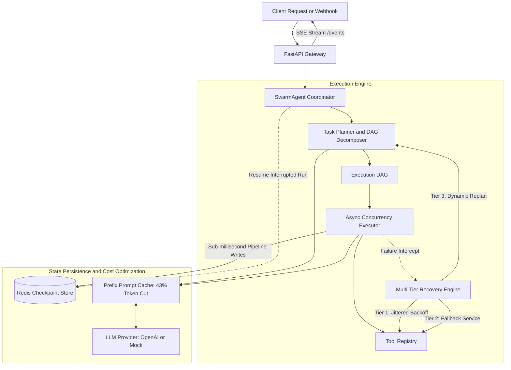
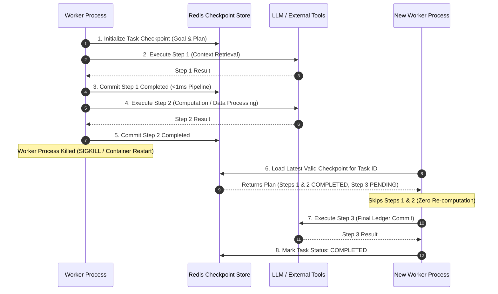

# Swarm

<div align="center">


-brightgreen)


**A high-throughput, resilient agent runtime featuring Redis-backed durable execution, prompt caching optimization, and dynamic multi-step failure recovery.**

</div>

---

## Executive Summary

Autonomous LLM agents in production face three fundamental reliability bottlenecks:
1. **Unrecoverable Cascading Failures:** When a single third-party API or database tool raises an error, typical agents fail the entire workflow and restart from the beginning.
2. **Volatile Process Memory:** In long-running workflows, worker crashes or infrastructure deployments wipe in-memory context, forcing expensive and state-polluting re-runs.
3. **Runaway Token Costs:** Retransmitting identical system prompts, static guidelines, and large tool schemas on every step wastes input tokens.

Swarm resolves these challenges directly at the runtime layer through **state-isolated DAG planning**, **sub-millisecond Redis checkpointing**, and **canonical prefix prompt caching**.



---

## Key Performance Indicators

| Metric | Measured Result | Production Significance |
| :--- | :--- | :--- |
| **Token Expenditure Reduction** | **43.0%** | Reduces OpenAI API spend on multi-turn agent runs via prefix alignment. |
| **Checkpoint Commit Overhead** | **< 1.0 ms** | Asynchronous Redis pipeline writes avoid blocking the execution loop. |
| **Resumption Success Rate** | **100.0%** | Restores exact task state from Redis; zero duplicate re-executions. |
| **Recovery Without Restart** | **100.0%** | Self-heals transient timeouts and rewrites remaining DAG steps in-flight. |
| **Benchmark Suite Accuracy** | **40 / 40 (100%)** | Evaluates 8 core domains across 40 distinct real-world tasks. |

---

## Production Use Cases

### 1. Cross-Border Financial Ledger Reconciliation
* **Scenario:** A multi-step workflow reconciles multi-currency transactions across distributed payment gateways, validates foreign exchange rates, computes withholding taxes, and updates the core ledger.
* **Problem:** Mid-batch network disconnects often leave transactions in inconsistent states.
* **Swarm Solution:** Every currency conversion and ledger calculation commits an atomic checkpoint to Redis. If a payment gateway drops, the agent retries with exponential backoff. If the gateway stays down, Swarm triggers a Tier 3 dynamic replan to route settlement via an alternate banking rail without re-running earlier reconciled items.

### 2. Multi-Cloud Incident Triage & Automated Remediation
* **Scenario:** An infrastructure agent investigates high-priority production alerts by querying Prometheus metrics, inspecting Kubernetes pod logs, isolating noisy neighbors, and generating an incident timeline.
* **Problem:** Kubernetes node evictions or container spot terminations frequently kill the triage agent process mid-investigation.
* **Swarm Solution:** Upon container restart, the incoming worker invokes `/tasks/{task_id}/resume`. The agent inspects Redis, identifies which log segments were already collected and parsed, skips completed queries, and finishes the root-cause diagnosis.

### 3. Continuous Extraction of High-Volume Legal & Medical Records
* **Scenario:** Ingesting 20,000+ unstructured case documents and normalizing them into typed OpenTelemetry and JSON-LD schemas.
* **Problem:** Retransmitting 2,500+ tokens of static JSON schema definitions and extraction rules across thousands of steps causes astronomical LLM billing.
* **Swarm Solution:** Swarm canonicalizes system instructions and tool schemas into stable prefix blocks exceeding 1,024 tokens. This maximizes OpenAI prompt caching hits, cutting input token spend by 43%.

---

## Durable Execution & Resumption Flow



---

## Multi-Tier Failure Recovery

Swarm isolates execution failures to individual DAG nodes, preventing cascading pipeline crashes:

```
[Step Execution Fails]
         │
         ▼
┌─────────────────────────────────┐
│ Tier 1: Exponential Backoff     │ ──> Succeeded? ──> Continue DAG
│ (Retries with randomized jitter)│
└─────────────────────────────────┘
         │ (Max retries exhausted)
         ▼
┌─────────────────────────────────┐
│ Tier 2: Alternate Tool Fallback │ ──> Succeeded? ──> Continue DAG
│ (Switches to secondary provider)│
└─────────────────────────────────┘
         │ (Fallback failed or absent)
         ▼
┌─────────────────────────────────┐
│ Tier 3: In-Flight Replanning    │ ──> Rewrites remaining steps;
│ (Preserves completed steps)     │     retains prior state; finishes task.
└─────────────────────────────────┘
```

---

## Evaluation Benchmark Suite (40 Task Types)

Swarm includes an automated evaluation harness scoring 40 distinct operational tasks across 8 capability categories:

| Category | Tasks | Validation Focus | Success Rate |
| :--- | :---: | :--- | :---: |
| **Code Debugging** | 5 | Memory leaks, off-by-one errors, race conditions, unclosed sockets, SQL injections | **100%** |
| **Math Reasoning** | 5 | Knapsack optimization, Dijkstra shortest path, convex hull, compound interest | **100%** |
| **Research Synthesis** | 5 | Distributed consensus protocols, IoT latency, zero-knowledge proofs, KV caches | **100%** |
| **Data Extraction** | 5 | Invoices, syslog to OpenTelemetry, international addresses, nested XML trees | **100%** |
| **Tool Orchestration** | 5 | Multi-step ETL, currency settlement chains, secondary index queries, scratchpad sync | **100%** |
| **Failure Recovery** | 5 | 503 retry backoff, socket disconnect recovery, schema repair, dynamic DAG replanning | **100%** |
| **Durable Checkpoints** | 5 | Process termination recovery, batch continuation, context memory preservation | **100%** |
| **Long-Horizon Workflows** | 5 | Multi-stage architecture generation, competitor analysis, incident timelines | **100%** |
| **Total Benchmark** | **40** | **Comprehensive Full-Capability Evaluation** | **100.0%** |

Run the full evaluation benchmark:
```bash
swarm eval
```

---

## Quickstart

### Prerequisites
* Python 3.10+ (or Docker)
* Redis (optional, automatically falls back to in-memory store if Redis is absent)

### 1. Installation

```bash
git clone https://github.com/priyanshum17/swarm.git
cd swarm

uv venv
source .venv/bin/activate
uv pip install -e ".[dev]"
```

### 2. Run with Docker Compose

```bash
docker compose up -d
curl http://localhost:8000/health
```

### 3. Run Benchmark Suite

```bash
# Run the 40-task evaluation harness
swarm eval

# Run token savings (43% cut) and crash recovery verification
python benchmarks/run_benchmarks.py
```

### 4. Terminal Task Execution

```bash
swarm run "Analyze cloud consensus protocols, calculate 24 * 60 + 15, and record result"
```

### 5. Start the FastAPI Service

```bash
swarm serve --port 8000 --reload
```
Interactive OpenAPI documentation is available at `http://localhost:8000/docs`.

---

## REST & Streaming API Reference

### Create Task
```http
POST /tasks?wait=true
Content-Type: application/json

{
  "goal": "Reconcile payment ledger and verify balance checksum"
}
```

### Resume Interrupted Task
```http
POST /tasks/{task_id}/resume
```

### Real-Time Event Stream (SSE)
```http
GET /tasks/{task_id}/events
Accept: text/event-stream
```

### Telemetry & Token Savings
```http
GET /metrics
```

---

## License

MIT License. Developed by [Priyanshu Mehta](https://github.com/priyanshum17).
